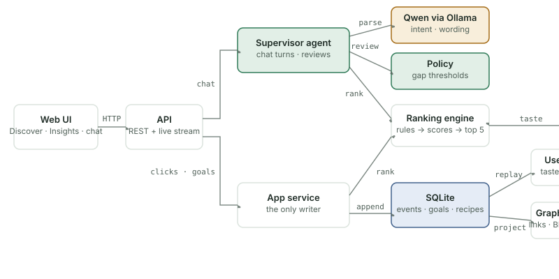
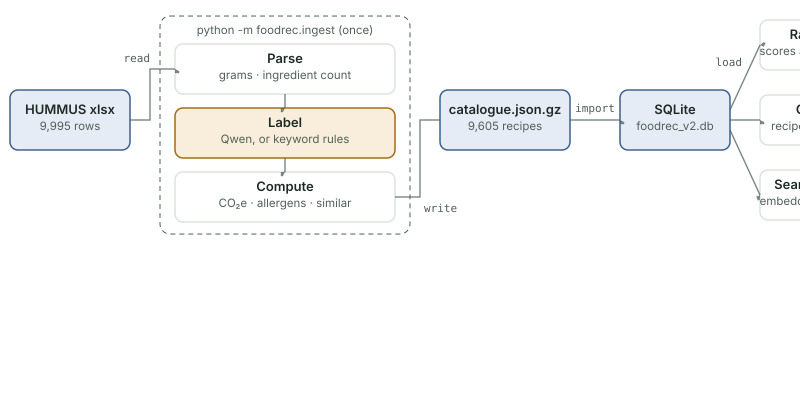
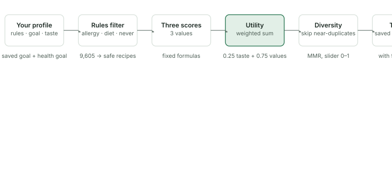
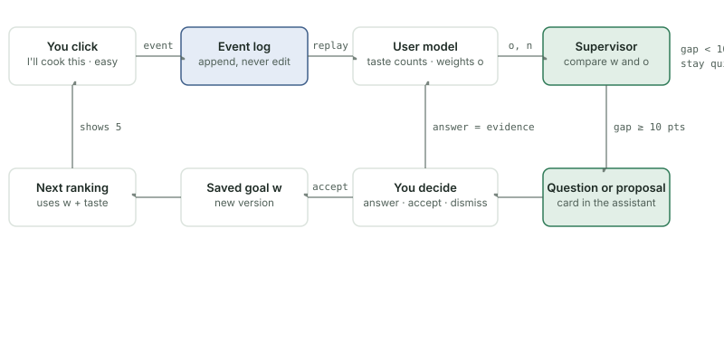
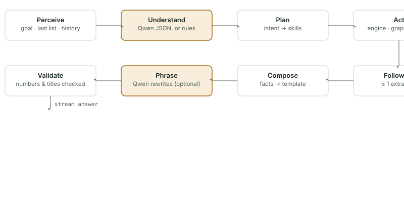
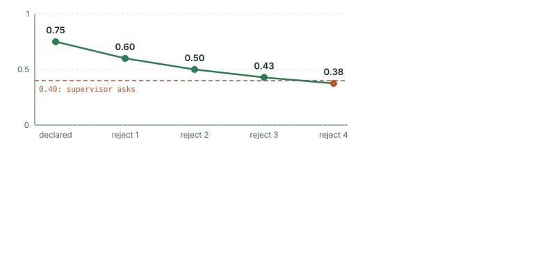

<!-- Generated from docs/guide/index.html (the interactive version) by docs/guide/convert.py. Edit index.html and run: python docs/guide/convert.py -->

<sub>FoodRec v0.3 · complete guide</sub>

# FoodRec: how it works, how it learns, and the math

FoodRec recommends five recipes from 9,605 real HUMMUS recipes. A fixed formula ranks them; two small models learn from what the user does; an AI supervisor watches the gap between what the user says and what they do, and asks before anything changes. This guide covers the system (Part I), the user model (Part II) and every equation (Part III).

*Colours in the figures:* agent and decision logic · language model (Qwen) · stored data · deterministic code

## Contents

- [Part I · How FoodRec works](#p1)
   - [Who talks to whom](#components)
   - [From HUMMUS to the database](#data)
   - [Getting five recipes](#ranking-flow)
   - [Taste: why it is in the ranking, and what changes it](#taste-why)
   - [What one click sets off](#loop)
   - [One chat turn](#chat)
   - [Why nothing is lost](#storage)
- [Part II · The user and the user model](#p2)
   - [Five questions, two kinds of answer](#onboarding)
   - [One session, screen by screen](#journey)
   - [Taste: counting likes and dislikes](#taste-model)
   - [Values: what the user actually prioritises](#value-model)
   - [Every interaction and what it changes](#interactions)
   - [When it speaks up](#supervisor)
- [Part III · Model equations](#p3)
   - [Notation used throughout](#notation)
   - [Criterion scores](#scores)
   - [Ranking](#ranking)
   - [Taste model](#taste)
   - [Value model](#values)
   - [Supervisor policy](#policy)
   - [Which equation each event runs](#events)
   - [Parameters and why each value](#params)

<a name="p1"></a>

## Part I · How FoodRec works

*Components, data, ranking, the learning loop, the assistant and storage.*

<a name="components"></a>

<sub>1.1 · Components</sub>

### Who talks to whom

The browser talks to one API. Chat goes to the supervisor agent; clicks and saved goals go to the app service. The service is the only part that writes. It appends an event to SQLite, and the user model and the knowledge graph are rebuilt from those events.



*The language model only reads the message and words the answer. Ranking, the policy and every number come from deterministic code that reads the same database.*

<a name="data"></a>

<sub>1.2 · Data</sub>

### From HUMMUS to the database

The ingest step runs once on your machine and writes one portable file. On every start the app checks that file's version. If it is new, the app copies the recipes into SQLite; if not, it skips the copy. The search index is built from the same recipes and its embeddings are cached, so later starts are fast.



*Qwen only labels: each ingredient gets a food group, and each recipe gets a cuisine and a meal type (or "not food", which drops it). Answers that fail validation fall back to keyword rules. Labels are cached in `labels.json`, so a run can resume.*

- **Healthiness**: Nine nutrient factors per 100 g, each scored on a straight line between a good and a poor anchor, then averaged with the health goal's weights.
- **Sustainability**: Grams of each ingredient × its food group's kg CO₂e per kg, divided by total grams. Log scale: 0.5 → 1, 30 → 0.
- **Convenience**: Number of ingredients: 3 → 1, 15 → 0.

<a name="ranking-flow"></a>

<sub>1.3 · Ranking</sub>

### Getting five recipes

Every list goes through the same six steps. Rules remove recipes before anything is scored, so an allergen can never be outweighed by a good score.



*The meal selector and chat filters ("at most 8 ingredients") add rules for one request only. Every list is stored with the goal and profile versions that produced it.*

<a name="taste-why"></a>

<sub>2½ · foodrec/__init__.py (TASTE_SHARE) · learner.py</sub>

### Taste: why it is in the ranking, and what changes it

The user sets three values with sliders. Taste is a fourth term in the ranking that the user does not set: the app learns it from what the user does. This section explains why it is there, why it counts for 25 %, and exactly which interactions change it.

<a name="e2w"></a>

#### A · Why taste is part of the ranking

<sub>Code: `ranker.effective_weights`</sub>

```math
U(i) = \underbrace{0.25 \cdot P(i)}_{\text{taste, learned}} \; + \; \underbrace{0.75 \cdot \big(w_h x_h(i) + w_s x_s(i) + w_t x_t(i)\big)}_{\text{the three values, set by the user}}
```

> **The problem it solves**
>
> - Healthiness, sustainability and convenience describe the **dish**. None of them says whether **this user** would enjoy it.
> - Without taste, two users with the same sliders would get identical lists, whatever they like.
> - Likes, dislikes, rejections "not my taste" and the dishes picked at onboarding would have no effect on what is recommended.
> - A dish that scores well on all three values but that the user dislikes would keep coming first.
>

> **Why it is a fixed share, not a fourth slider**
>
> The user is asked for exactly three parameters. Keeping taste out of the sliders means they mean exactly what the user set: "50 % healthiness" is half of the value part. Taste is also consistently the strongest driver of real food choice, so a recommender that ignores it is quickly ignored by its users.
>

<a name="e2tau"></a>

#### B · Why 0.25

<sub>Code: `TASTE_SHARE = 0.25`</sub>

```math
\Delta U = 0.25 \times \Delta P \qquad \text{e.g. } \Delta P = 0.4 \ \Rightarrow\ \Delta U = 0.10
```

- $`\Delta P`$: difference in taste match between two dishes
- $`\Delta U`$: the resulting difference in utility

> **Reasoning (a design choice, not a calibrated value)**
>
> 0.25 is large enough that taste decides between dishes that score similarly on the three values, and small enough that it can never override them: even a strong taste difference moves utility by only about 0.10, while the value part can move it by up to 0.75. It has not been fitted to user data.
>

> **Alternatives**
>
> - **Calibrate it** (recommended for an evaluation): collect choices in a user study and choose the τ that best predicts which of the five dishes people picked (a conditional-logit fit).
> - **Adaptive τ**: start near 0 and grow with taste evidence, e.g. $`\tau = 0.25 \cdot n/(n+5)`$.
> - **Taste as a filter**: drop dishes with $`P < 0.35`$, then rank on the three values only.
> - **Multiplicative utility**: $`U = P^{\tau} V^{1-\tau}`$, so a strongly disliked dish cannot win.
> - **An advanced setting** where the user chooses τ.
>

<a name="e2chg"></a>

#### C · What changes taste

<sub>Code: `TasteModel · Learner._feedback`</sub>

```math
\theta_c = \frac{1 + \text{likes}_c}{2 + \text{likes}_c + \text{dislikes}_c} \qquad P(i) = \sum_c \pi_c(i)\, \theta_c
```

Every action below adds to the likes or dislikes of **every** concept of the dish (its cuisine, its ingredients, its food groups).

| Action | Effect on taste |
|---|---|
| Like | +1 like |
| I'll cook this | +0.8 like (+1.0 with "it sounds tasty") |
| Save | +0.6 like |
| Not for me: "not my taste" | +1 dislike |
| Not for me: "had it recently" | +0.5 dislike |
| Liking or soft dislike declared at onboarding | starts at 2 likes / 2 dislikes |
| Dish picked at onboarding | +1 like |
| Correction on Insights (Like / Neutral / Dislike) | set to 0.85 / 0.5 / 0.15 |

> **What does not change taste**
>
> Moving or saving the sliders, the meal selector, chat filters, and rejections with a value reason ("not healthy enough", "not sustainable", "too many ingredients"). Those reasons say why the dish was rejected, and it was not the flavour, so they update the value model instead.
>

<a name="e2who"></a>

#### D · So what do interactions change?

<sub>Code: `learner.py · service.py`</sub>

Taste is not the only thing that learns. Interactions update two learned quantities, while the user's stated values change only by an explicit decision.

| Quantity | What it is | Changed by | Used for |
|---|---|---|---|
| Taste $`\theta_c`$, $`P(i)`$ | how much the user likes each cuisine, ingredient, food group | likes, saves, choices, taste rejections, onboarding, corrections (table C) | **ranking** (25 % of utility) |
| Observed weights $`o`$ | how much the user's behaviour weighs health, sustainability, convenience | choices, value-reason rejections, answers to trade-off questions | Insights and the **supervisor**; not used for ranking |
| Stated weights $`w`$ | the three sliders, the saved goal | only "Save as goal" or accepting a supervisor proposal | **ranking** (75 % of utility) |

> **Why it is split this way**
>
> Taste is something the user cannot easily state for 9,605 dishes, so the app learns it and uses it directly. The value weights are something the user did state, so the app never overrides them silently: when behaviour drifts from the stated values, the supervisor asks or proposes, and the user decides.
>

```text
utility = 0.25 × taste + 0.75 × (w_h × health + w_s × sustainability + w_t × convenience)
```

<a name="loop"></a>

<sub>1.4 · Learning loop</sub>

### What one click sets off

A click is stored as an event and never edited. The user model replays it. The supervisor then compares the saved goal w with the observed weights o. If the gap is big enough, it asks a question or proposes a change. The goal changes only when the user saves it or accepts a proposal.



*An answered question flows back into the user model as evidence. A dismissed topic is left alone for 6 feedback events.*

<a name="chat"></a>

<sub>1.5 · The assistant</sub>

### One chat turn

Every message goes through the same eight stages, and each stage appears as a step in the thinking timeline above the answer. Qwen is used in two of them. If it is unavailable or returns something invalid, keyword rules and templates take over.



*Understand picks one of 10 intents (recommend, explain, compare, what-if, why, history, knowledge, profile change, review, help) and fills a fixed schema. Validate rejects any number or recipe title that the tools did not produce.*

<a name="storage"></a>

<sub>1.6 · Storage</sub>

### Why nothing is lost

- **Event log**: Every click, answer and goal save is appended and never edited. The user model is a replay of this log, so it can be rebuilt at any time.
- **Versions**: Profiles and goals get a new version on each save. Any earlier goal can be restored from the Profile page.
- **Snapshots**: Each list of five is stored with the versions that produced it, so "what changed?" compares two recorded lists.

<a name="p2"></a>

## Part II · The user and the user model

*What the user is asked, what they do on each screen, and exactly how each interaction updates the two models.*

<a name="onboarding"></a>

<sub>2.1 · Onboarding</sub>

### Five questions, two kinds of answer

Some answers are `rules` that remove recipes and are never relaxed. The others are `preferences` that ranking trades off.

| Step | Question | Kind | What it does |
|---|---|---|---|
| 1 | Allergies and diets | `rule` | Recipes with the allergen, or with unknown allergen data, are never shown. |
| 2 | Liked and disliked cuisines and ingredients; "never include" | `rule` `pref.` | "Never include" filters. Likes and dislikes start the taste model at 2 likes or 2 dislikes. |
| 3 | Health goal: eat healthier, lose weight, gain weight, build muscle, heart-friendly, less sugar. Optional ingredient limit. | `pref.` | Sets the weights of the nine health factors (build muscle weights protein ×4). The limit is strict or soft. |
| 4 | A few dishes you like | `pref.` | One like for each cuisine, ingredient and food group of the dish. |
| 5 | How much healthiness, sustainability and convenience should count | `pref.` | The **stated weights** w<sub>h</sub>, w<sub>s</sub>, w<sub>t</sub>, summing to 1. Saved as goal version 1. |

<a name="journey"></a>

<sub>2.2 · User journey</sub>

### One session, screen by screen

- **Onboarding**: Five steps (section 1). Creates profile v1 and goal v1, starts the taste counts and sets observed weights = stated weights. Event: `profile_created`.
- **Discover**: Shows the top five. The user can move the three sliders and press **Apply** (this list only, nothing learned), pick a meal (breakfast, lunch, dinner, snack, dessert, drink; this request only), or press **Save as goal** (new goal version). Every list is stored as a snapshot.
- **Recipe card**: Like, Save, **I'll cook this** with a reason, **Not for me** with a reason, **How it's scored** (the full calculation), and **Ask** (sends a question to the assistant). Each feedback click is one event.
- **After feedback**: The user model replays the event, then the supervisor runs its check. Its reasoning appears in the assistant's Supervisor tab. A question or proposal shows up as a card there.
- **Assistant**: Docked on every page. Chat requests ("something easy with at most 8 ingredients") become request-only filters and are never saved. Answers show a thinking timeline with the source of each fact.
- **Insights**: Preference match, **You chose** vs. **You do** for each value, every event that moved the weights, and the taste table with Like / Neutral / Dislike corrections.
- **Profile**: Edit rules, the health goal and the ingredient limit (new profile version), or restore an earlier goal version.

<a name="taste-model"></a>

<sub>2.3 · Model 1</sub>

### Taste: counting likes and dislikes

```text
taste(concept) = (1 + likes) / (2 + likes + dislikes)        0.5 = no opinion yet
```

Concepts are cuisines, ingredients and food groups. A dish's taste match is the weighted mean of its concepts (cuisine 35 %, ingredients 45 % by weight, food groups 20 %). A like counts 1 on every concept of the dish, "I'll cook this" 0.8 (1.0 with "it sounds tasty"), save 0.6, and "not my taste" counts 1 dislike. A liking declared at onboarding starts at 2 likes.



*Example: the user said they like Italian (2 likes, 0.75), then rejected four Italian dishes as "not my taste". After the fourth, taste is 3 / 8 = 0.375, below 0.40, so the supervisor asks "Do you still want Italian as a preference?"*

<a name="value-model"></a>

<sub>2.4 · Model 2</sub>

### Values: what the user actually prioritises

The observed weights start equal to the stated weights. Each choice moves them toward the values on which the chosen dish beat the other four shown.

```text
d_k  = score_k(chosen) − mean_k(the five shown)      (+0.2 if the reason names k)
o_k ← o_k × e^(d_k)
then rescale to sum 1, and mix in 5 % of the stated goal
```

#### Worked example: choosing "Quick tomato pasta" because "it is easy"

| Value | Chosen | Mean of five | d | Before | After |
|---|---|---|---|---|---|
| Healthiness | 0.55 | 0.72 | −0.17 | 0.40 | 0.31 |
| Sustainability | 0.74 | 0.63 | +0.11 | 0.40 | 0.40 |
| Convenience | 0.92 | 0.60 | +0.32 + 0.2 | 0.20 | 0.29 |

| Observed weights after the choice compared with stated weights | |
|---|---|
| Healthiness | 0.31 (−9 pts) |
| Sustainability | 0.40 (0 pts) |
| Convenience | 0.29 (+9 pts) |

| Other updates | Effect on observed weights |
|---|---|
| Rejected as "not healthy enough", "not sustainable" or "too many ingredients" | Only that value moves, by how much worse the rejected dish was than the average shown. Nothing moves if it was not worse. |
| Answered a trade-off question | Winner × e<sup>0.2</sup>, loser × e<sup>−0.2</sup>. |
| Saved a goal or accepted a proposal | Move halfway to the new goal; the event count restarts. |
| Like, save, "not my taste" | None. These only update taste. |

#### Worked example (the interactive simulator of the HTML version)

Stated goal: health 40 %, sustainability 40 %, convenience 20 %. Five example dishes are shown each time:

| Shown dish (example) | Health | Sust. | Conv. |
|---|---|---|---|
| Lentil and spinach soup | 0.82 | 0.88 | 0.42 |
| Quick tomato pasta | 0.55 | 0.74 | 0.92 |
| Grilled salmon with greens | 0.86 | 0.52 | 0.58 |
| Beef and bean chilli | 0.61 | 0.18 | 0.33 |
| Chickpea salad wrap | 0.74 | 0.81 | 0.75 |

The user chooses the **quick tomato pasta** with the reason *it is easy*, eight times in a row. Same
arithmetic as the app (multiplicative update, +0.2 nudge for a consistent reason, 5 % anchor to the goal):

| Choice | Observed health | Observed sust. | Observed conv. | Match | Confidence | Supervisor |
|---|---|---|---|---|---|---|
| 1 | 31 % | 40 % | 29 % | 91 % | 17 % | stays quiet |
| 2 | 23 % | 37 % | 40 % | 80 % | 29 % | stays quiet |
| 3 | 16 % | 33 % | 51 % | 69 % | 38 % | asks a trade-off question about convenience |
| 4 | 12 % | 28 % | 61 % | 59 % | 44 % | asks a trade-off question about convenience |
| 5 | 8 % | 23 % | 69 % | 51 % | 50 % | asks a trade-off question about convenience |
| 6 | 7 % | 18 % | 75 % | 45 % | 55 % | proposes moving convenience to 48 % |
| 7 | 5 % | 15 % | 80 % | 40 % | 58 % | proposes moving convenience to 50 % |
| 8 | 5 % | 12 % | 83 % | 37 % | 62 % | proposes moving convenience to 52 % |

> The interactive version, where you can choose and reject dishes yourself, is in the HTML guide:
> open `docs/guide/index.html` in a browser, or **How FoodRec works** in the app's account menu.

<a name="interactions"></a>

<sub>2.5 · Reference</sub>

### Every interaction and what it changes

Everything is recorded as an event in an append-only log. The user model is rebuilt by replaying that log, so each row below is the complete effect of that interaction.

| Interaction | Taste model | Observed weights | Goal / rules |
|---|---|---|---|
| Like | +1 like on every concept of the dish | no change | no change |
| Save | +0.6 like | no change | no change |
| I'll cook this, no reason | +0.8 like | o<sub>k</sub> × e<sup>d<sub>k</sub></sup> for all three, d = chosen − mean of the five | no change |
| … "it sounds tasty" | +1.0 like | same as no reason | no change |
| … "it is healthy / climate-friendly / easy" | +0.8 like | same, plus 0.2 on that value; ignored and flagged if the dish is not actually better on it | no change |
| Not for me: "not my taste" | +1 dislike | no change | no change |
| Not for me: "had it recently" | +0.5 dislike | no change | no change |
| Not for me: "not healthy enough / not sustainable / too many ingredients" | no change | only that value: o<sub>k</sub> × e<sup>d</sup>, d = mean of the five − rejected; ignored if the dish was not worse | no change |
| Answer a trade-off question | no change | winner × e<sup>0.2</sup>, loser × e<sup>−0.2</sup> | no change |
| Dismiss a question or proposal | no change | no change | no change; topic paused for 6 feedback events |
| Accept a proposal | no change | move halfway to the new goal; event count restarts | new goal version |
| Save as goal (Discover) | no change | move halfway to the new goal; event count restarts | new goal version |
| Answer "Do you still want Italian?" with No | no change | no change | removed from declared likes (new profile version) |
| Correct a taste belief (Insights) | counts replaced: Like 0.85, Neutral 0.5, Dislike 0.15, worth 6 observations | no change | no change |
| Edit profile | only newly added likes/dislikes start at 2 counts; learned counts are kept | no change | new profile version |
| Apply sliders, meal selector, chat filters | no change | no change | no change; this request only |

After every weight update: rescale to sum 1, then mix in 5 % of the stated goal. Only choices, reasoned rejections and answers count as events for confidence and for the supervisor's minimum-event rules.

<a name="supervisor"></a>

<sub>2.6 · The supervisor</sub>

### When it speaks up

| Condition | Action |
|---|---|
| Every gap below 10 points | Stay quiet. |
| A gap of 10+ points after 3+ events | Ask: "When convenience and healthiness pull in different directions, which usually wins for you?" |
| A gap of 15+ points after 6+ events | Propose moving that weight halfway, with a preview of which recipes would enter or leave the top five. |
| A declared liking below 0.40 with 2+ evidence | Ask whether to keep it. |

Confidence = n / (n + 5), where n counts choices, reasoned rejections and answers since the goal was saved. One question is open at a time.

<a name="p3"></a>

## Part III · Model equations

*Every formula exactly as the code computes it, with the file it comes from.*

<a name="notation"></a>

<sub>FoodRec v0.3 · Part III · model equations</sub>

# Every equation, explained

Each equation below comes with three things: what every symbol means, how the app uses the result, and why this formula was chosen over the alternatives. The formulas are written exactly as the code computes them, and each card names its source file.

A note on honesty: the anchors come from published nutrition and climate sources, but the learning rates and thresholds are design choices. They were picked to be simple, explainable and stable, not fitted to data, and they still need calibration with real users.

<a name="notation"></a>

<sub>0</sub>

### Notation used throughout

| Symbol | Meaning | Range |
|---|---|---|
| $`i, j`$ | a recipe from the catalogue | 9,605 recipes |
| $`k`$ | one of the three user values: $`h`$ healthiness, $`s`$ sustainability, $`t`$ convenience | $`\{h,s,t\}`$ |
| $`x_k(i)`$ | score of recipe $`i`$ on value $`k`$; 1 is best, 0 is worst | $`[0,1]`$ |
| $`P(i)`$ | taste match: how much this user is likely to enjoy recipe $`i`$ | $`[0,1]`$ |
| $`w_k`$ | **stated weight**: how much the user said value $`k`$ matters (sliders, saved goal) | $`\ge 0`$, sum 1 |
| $`o_k`$ | **observed weight**: how much the user's behaviour shows value $`k`$ matters | $`\ge 0`$, sum 1 |
| $`c`$ | a concept: a cuisine, an ingredient or a food group | e.g. `cuisine:Italian` |
| $`S`$ | the five recipes on screen when the user clicked | $`\|S\| = 5`$ |
| $`n`$ | number of informative events (choices, reasoned rejections, answers) since the goal was last saved | $`0, 1, 2, \dots`$ |

<a name="scores"></a>

<sub>1 · foodrec/features.py</sub>

### Criterion scores

Every recipe gets a score from 0 to 1 on each of the three values. These scores do not depend on the user (except for the health goal), so they are the fixed, explainable facts that the rest of the system builds on.

<a name="e11"></a>

#### 1.1 · Anchor score of one factor

<sub>Code: `features._lin`</sub>

```math
\ell(v;\, g, b) = \operatorname{clip}_{[0,1]}\!\left(\frac{v - b}{g - b}\right)
```

**Symbols**

- $`v`$: the measured value, for example 8 g of saturated fat per 100 g
- $`g`$: the "good" anchor: at or better than this the factor scores 1 (sat. fat 1.5 g)
- $`b`$: the "poor" anchor: at or worse than this the factor scores 0 (sat. fat 5 g)
- $`\operatorname{clip}_{[0,1]}`$: cuts the result to the range 0 to 1, so values beyond an anchor do not go below 0 or above 1

> **How the app uses it**
>
> Every health factor is turned into a 0–1 score with this formula. The same shape is used for convenience (1.4). The "How it's scored" panel on each recipe card lists $`v`$, $`g`$, $`b`$ and the resulting score for every factor.
>

> **Why this formula**
>
> Nutrition guidelines already define thresholds: the UK FSA traffic lights say what is "low" (green) and "high" (red) per 100 g. Using those as the two anchors means every score is traceable to a published source. A straight line between them is the simplest monotone mapping, and anyone can check it by hand. It works in either direction: when more is better (fibre, protein), $`g > b`$ and the same formula still holds.
>

**Example.** Sat. fat 3.2 g: $`(3.2 - 5)/(1.5 - 5) = 0.51`$.

<a name="e12"></a>

#### 1.2 · Healthiness under a health goal

<sub>Code: `features.healthiness`</sub>

```math
h_f(i) = \begin{cases} 1 - \ell(v_f; g_f, b_f) & f \in F^G \\ \ell(v_f; g_f, b_f) & \text{otherwise} \end{cases} \qquad x_h(i) = \frac{\sum_{f \in \mathcal{A}(i)} \alpha_f^G\, h_f(i)}{\sum_{f \in \mathcal{A}(i)} \alpha_f^G}
```

**Symbols**

- $`f`$: one of nine health factors (table below)
- $`G`$: the user's health goal chosen at onboarding (eat healthier, lose weight, gain weight, build muscle, heart-friendly, less sugar)
- $`\alpha_f^G`$: how important factor $`f`$ is for goal $`G`$; 1 unless the goal says otherwise
- $`F^G`$: factors the goal reverses. Only "gain weight" uses it: high energy becomes good
- $`h_f(i)`$: score of recipe $`i`$ on factor $`f`$, from 1.1
- $`\mathcal{A}(i)`$: the factors that have a value for this recipe (missing nutrients are skipped)
- $`x_h(i)`$: the final healthiness score, a weighted average of the factor scores

| Factor | Measured per 100 g | Good $`g`$ | Poor $`b`$ | Source of anchors |
|---|---|---|---|---|
| Energy | kcal | 125 | 400 | WCRF energy-density bands |
| Total fat | g | 3 | 17.5 | FSA traffic light |
| Saturated fat | g | 1.5 | 5 | FSA traffic light |
| Sugars | g | 5 | 22.5 | FSA traffic light |
| Sodium | mg | 120 | 600 | FSA (salt 0.3 / 1.5 g) |
| Cholesterol | mg | 20 | 100 | low-cholesterol claim level |
| Fibre | g | 6 | 0 | EU "high fibre" claim |
| Protein | % of energy $`= \min(100, 400\,p/E)`$ | 20 | 0 | EU "high protein" claim |
| FSA score | HUMMUS normalised FSA score | 1 | 0 | HUMMUS dataset |

Protein: $`p`$ grams of protein give $`4p`$ kcal, so $`4p/E \times 100`$ is the share of energy from protein. Goal weights: lose weight (energy 3, fat 2, sugars 2, fibre 2, protein 1.5); gain weight (energy 2 reversed, protein 2, fat 0.5, FSA 0.5); build muscle (protein 4, energy 0.5, fat 0.5); heart-friendly (sat. fat 3, sodium 3, cholesterol 2, fibre 2); less sugar (sugars 4, fibre 1.5, energy 1.5); eat healthier (all 1).

> **How the app uses it**
>
> $`x_h`$ is the healthiness score in ranking (2.1) and the A–E grade on each card (A ≥ 0.80, B ≥ 0.65, C ≥ 0.50, D ≥ 0.35, else E). Changing the health goal in Profile changes $`\alpha`$ and $`F`$, so the same dish can score differently for two users.
>

> **Why this formula**
>
> A weighted average keeps every factor visible: the breakdown can show exactly how much each nutrient pulled the score up or down. A single external index like Nutri-Score would hide that, and it cannot adapt to a goal. Changing only the weights per goal means "build muscle" and "lose weight" use the same nine facts but value them differently, which is easy to explain. Skipping missing nutrients (instead of treating them as 0 or average) avoids inventing data.
>

<a name="e13"></a>

#### 1.3 · Sustainability (climate footprint)

<sub>Code: `ingest/build.py · features.sustainability`</sub>

```math
\text{CO}_2(i) = \frac{\sum_j m_j\, e_j}{\sum_j m_j}, \qquad x_s(i) = \operatorname{clip}_{[0,1]}\!\left(\frac{\ln 30 - \ln \text{CO}_2(i)}{\ln 30 - \ln 0.5}\right)
```

**Symbols**

- $`j`$: an ingredient of the recipe (water is left out)
- $`m_j`$: its amount in grams, parsed from the ingredient line during ingest
- $`e_j`$: kg CO₂e emitted per kg of that ingredient's food group (beef ≈ 60, pulses ≈ 1), from Poore & Nemecek 2018 via Our World in Data
- $`\text{CO}_2(i)`$: estimated kg CO₂e per kg of the finished dish: a mass-weighted average
- 0.5, 30: the anchors: 0.5 kg/kg or less scores 1, 30 kg/kg or more scores 0
- $`\ln`$: natural logarithm

> **How the app uses it**
>
> $`\text{CO}_2(i)`$ is computed once at ingest and stored with a per-ingredient breakdown. The card shows it in kg CO₂e, and "How it's scored" lists which ingredients contribute most. $`x_s`$ is the sustainability score used in ranking.
>

> **Why this formula**
>
> Per kg of dish (not per serving) makes recipes comparable regardless of portion size, which HUMMUS records inconsistently. Food-group factors are the most widely cited source that covers every ingredient. The log scale matters because footprints span two orders of magnitude: on a linear scale every beef dish would score 0 and every plant dish would be squeezed near 1. On a log scale, halving the footprint gains the same score anywhere on the range, which matches how people think about "cutting emissions by half". Water is excluded because it weighs a lot but emits nothing, and would make soups look misleadingly clean.
>

<a name="e14"></a>

#### 1.4 · Convenience

<sub>Code: `features.convenience`</sub>

```math
x_t(i) = \operatorname{clip}_{[0,1]}\!\left(\frac{15 - N(i)}{15 - 3}\right)
```

**Symbols**

- $`N(i)`$: number of ingredients, counted from HUMMUS `ingredients_title`
- 3, 15: 3 or fewer ingredients score 1; 15 or more score 0

> **How the app uses it**
>
> The convenience score in ranking. The card shows the ingredient count; the user's ingredient limit (strict or soft) and chat requests like "at most 8 ingredients" use $`N(i)`$ directly.
>

> **Why this formula**
>
> HUMMUS has no reliable preparation time, but every recipe lists its ingredients. The count is a transparent proxy for effort (shopping, preparation, steps). It is the same anchor formula as 1.1, so users only have to learn one idea. The anchors cover the bulk of the catalogue: few recipes have fewer than 3 or more than 15 ingredients.
>

<a name="ranking"></a>

<sub>2 · ranker.py · engine.py · diversity.py · catalogue.py</sub>

### Ranking

Before any formula runs, rules remove ineligible recipes: declared allergens (unknown allergen data counts as unsafe), diets, "never include" ingredients, a strict ingredient limit, and request-only filters such as the meal selector. Duplicates are removed. Only the remaining recipes are scored.

<a name="e21"></a>

#### 2.1 · Utility: one number per recipe

<sub>Code: `ranker.effective_weights · ranker.utility`</sub>

```math
\beta_p = \tau, \qquad \beta_k = (1-\tau)\, w_k, \qquad U(i) = \beta_p\, P(i) + \sum_{k \in \{h,s,t\}} \beta_k\, x_k(i)
```

**Symbols**

- $`\tau = 0.25`$: the taste share: a fixed quarter of the utility always comes from taste
- $`w_k`$: the user's stated weights from the three sliders (sum to 1)
- $`\beta`$: the four final ranking weights; they also sum to 1
- $`P(i)`$: taste match (3.4)
- $`U(i)`$: utility: the recipe's overall fit for this user, between 0 and 1

> **How the app uses it**
>
> Recipes are sorted by $`U`$ before the diversity step (2.4). Each card shows its utility, and the explanation lists each term $`\beta_k x_k`$ so the user can see which value contributed most. Note that ranking always uses the **stated** weights $`w`$, never the observed ones: learning informs the supervisor, it does not silently change the ranking.
>

> **Why this formula**
>
> A weighted sum is the standard multi-criteria model (multi-attribute utility), and its key property here is controllability: if the user moves a slider, the effect on every recipe is predictable and explainable. Taste gets a fixed share instead of a slider for two reasons. The three sliders then mean exactly what the user set ("50 % health" really is half of the value part). And a dish the user would never eat cannot reach the top on numbers alone. 25 % was chosen so taste can break ties between similar dishes without overriding the user's stated values.
>

**Check.** $`w = (0.5, 0.3, 0.2)`$, $`P = 0.8`$, $`x = (0.9, 0.55, 0.85)`$: $`U = 0.25 \cdot 0.8 + 0.75 \cdot (0.45 + 0.165 + 0.17) = 0.78875`$. This is a test in `tests/test_reference.py`.

<a name="e22"></a>

#### 2.2 · When a score is missing

<sub>Code: `ranker.utility (policy "renormalize")`</sub>

```math
\tilde\beta_k = \frac{\beta_k}{\sum_{k' \notin M(i)} \beta_{k'}} \ \ \text{for } k \notin M(i), \qquad \tilde\beta_k = 0 \ \ \text{for } k \in M(i)
```

**Symbols**

- $`M(i)`$: the criteria with no score for recipe $`i`$ (for example, no nutrition data)
- $`\tilde\beta_k`$: the weights actually used for this recipe; they still sum to 1

> **How the app uses it**
>
> The recipe is ranked on the criteria it has, and its card says which criterion was missing. Two other policies exist for experiments: "zero" (missing counts as 0) and "exclude" (drop the recipe).
>

> **Why this formula**
>
> Filling a gap with the average would invent a fact; filling it with 0 would punish recipes for poor data rather than poor food. Renormalising keeps the user's relative priorities among the known criteria and is disclosed, so nothing is hidden.
>

<a name="e23"></a>

#### 2.3 · Candidate pool

<sub>Code: `engine._pool`</sub>

```math
C = \bigcup_{k \in \{p,h,s,t\}} \operatorname{top}_{15}(k) \ \cup\ \operatorname{top}_{60 - |\cdot|}(U)
```

**Symbols**

- $`\operatorname{top}_{15}(k)`$: the 15 best eligible recipes on criterion $`k`$ ($`15 = \lceil 60/4 \rceil`$)
- $`C`$: the pool of at most 60 recipes passed to the diversity step; filled up by utility

> **How the app uses it**
>
> Only applies when more than 60 recipes are eligible (almost always with 9,605). It keeps the diversity step fast.
>

> **Why this formula**
>
> Cutting purely by utility could remove every recipe that is excellent on one criterion but average overall, so diversity would have nothing different to choose from. Taking the best on each criterion first guarantees the pool contains specialists of every kind.
>

<a name="e24"></a>

#### 2.4 · Diversity: maximal marginal relevance

<sub>Code: `catalogue.vector · diversity.rerank`</sub>

```math
\operatorname{sim}(i,j) = \mathbf{v}_i \cdot \mathbf{v}_j, \qquad i^{*} = \arg\max_{i \in C \setminus R} \Big[ \lambda\, U(i) - (1-\lambda) \max_{j \in R} \operatorname{sim}(i,j) \Big], \quad \lambda = 1 - d
```

**Symbols**

- $`\mathbf{v}_i`$: a recipe's profile vector: cuisine 0.8, each ingredient its share of the dish's grams, each food group $`0.4/\sqrt{\#\text{groups}}`$; seasonings left out; scaled to length 1
- $`\operatorname{sim}(i,j)`$: cosine similarity, 0 (nothing in common) to 1 (identical profile)
- $`R`$: recipes already selected for the list
- $`d`$: the diversity slider on Discover (default 0.3)
- $`\lambda`$: how much utility counts versus being different from what is already chosen
- $`i^*`$: the next recipe added; repeated until five are chosen

> **How the app uses it**
>
> The first pick is the highest-utility recipe. Each next pick balances utility against similarity to the picks so far. When a recipe moves up because of variety, its card says so and names the higher-utility recipe it displaced.
>

> **Why this formula**
>
> Without it, the top five are often near-duplicates (five lentil soups). MMR is a standard, deterministic re-ranking method with one intuitive control: $`d = 0`$ gives pure utility order, higher $`d`$ gives more variety. Mixing cuisine, ingredients and food groups in the vector makes "similar" mean what a cook would mean.
>

<a name="taste"></a>

<sub>3 · learner.py (TasteModel) · preference.py</sub>

### Taste model

The first learned model answers "does this user like this kind of food?". It keeps a count of likes and dislikes for every concept the user has met.

<a name="e31"></a>

#### 3.1 · Taste of one concept

<sub>Code: `TasteModel.mean`</sub>

```math
\theta_c = \frac{1 + L^0_c + L_c}{2 + L^0_c + L_c + D^0_c + D_c}
```

**Symbols**

- $`c`$: a concept, e.g. `cuisine:Italian` or `ingredient:garlic`
- $`L^0_c, D^0_c`$: declared likes / dislikes from onboarding or a correction
- $`L_c, D_c`$: observed likes / dislikes from feedback (3.2)
- the 1 and 2: one imaginary like and one imaginary dislike, so a new concept starts at exactly 0.5
- $`\theta_c`$: estimated chance the user likes dishes with this concept, 0 to 1

> **How the app uses it**
>
> The Insights taste table shows $`\theta_c`$ for each concept, with its likes and dislikes. It feeds the taste match (3.4) and the supervisor's taste-conflict check (5.3).
>

> **Why this formula**
>
> This is Laplace's rule of succession, which is the posterior mean of a Beta(1, 1) distribution after the observed likes and dislikes. In plain words: it is the like-ratio with one imaginary vote each way. That gives three useful properties. An unseen concept is neutral (0.5), not 0 or 1. One single like cannot jump a concept to 100 % (one like gives 2/3). And the more evidence there is, the closer it gets to the true ratio. It is also the simplest learner that can be explained with a fraction, which was the goal of simplifying the user model.
>

**Example.** Declared liking (2 likes) and no feedback: $`3/4 = 0.75`$. After 4 "not my taste" rejections: $`3/8 = 0.375`$.

<a name="e32"></a>

#### 3.2 · Updating the counts

<sub>Code: `TasteModel.observe · Learner._feedback`</sub>

```math
\text{positive: } L_c \leftarrow L_c + a, \qquad \text{negative: } D_c \leftarrow D_c + a, \qquad \text{for every } c \in C(i)
```

**Symbols**

- $`C(i)`$: all concepts of the dish: its cuisine, its ingredients, its food groups
- $`a`$: the strength of the signal (table)

| User action | Counts as | $`a`$ | Reasoning for the strength |
|---|---|---|---|
| Like | like | 1.0 | a direct statement of liking |
| I'll cook this, "it sounds tasty" | like | 1.0 | a choice explicitly because of taste |
| I'll cook this (other or no reason) | like | 0.8 | chosen, but maybe for health or ease |
| Save | like | 0.6 | interest, not commitment |
| Dish picked at onboarding | like | 1.0 | the user named it as liked |
| Not for me, "not my taste" | dislike | 1.0 | a direct statement of disliking |
| Not for me, "had it recently" | dislike | 0.5 | weak; the dish may still be liked |
| Not for me with a value reason | no taste update; it updates the value model instead (4.3) |

> **How the app uses it**
>
> Every click on a card is stored as an event; replaying the events applies these updates. Insights lists, for each concept, which events changed it.
>

> **Why this formula**
>
> Adding the full strength to every concept (rather than splitting it by concept weight) means one rejected Italian dish moves "Italian" by a full vote. That makes the model react visibly and keeps the arithmetic shown on Insights simple (whole and half votes). Different strengths separate strong signals from weak ones without needing a learned model. A rejection with a value reason ("not healthy enough") is deliberately kept out of taste: the user said why they rejected it, and it was not the flavour.
>

<a name="e33"></a>

#### 3.3 · Declared tastes and user corrections

<sub>Code: `TasteModel.declare · TasteModel.override`</sub>

```math
\text{declared: } (L^0_c, D^0_c) = (2, 0) \text{ or } (0, 2) \qquad \text{correction to } m: \ L^0_c = m(T+2) - 1, \ \ D^0_c = (T+2) - 2 - L^0_c, \ \ L_c = D_c = 0
```

**Symbols**

- $`m`$: the value the user picks on Insights: Like 0.85, Neutral 0.5, Dislike 0.15 (kept within 0.05–0.95)
- $`T = 6`$: how many observations a correction is worth

> **How the app uses it**
>
> Onboarding likes and soft dislikes start a concept at 0.75 or 0.25. The Like / Neutral / Dislike buttons on Insights set it exactly to $`m`$ (substitute into 3.1 and it gives $`\theta_c = m`$), labelled "your correction".
>

> **Why this formula**
>
> A declaration is worth 2 votes: strong enough to matter from day one, weak enough that a few clear rejections can overturn it (which is what triggers the supervisor's check in 5.3). A correction is worth 6 votes because the user is explicitly overriding the model, so it should hold against a few contrary clicks but still not be permanent.
>

<a name="e34"></a>

#### 3.4 · Taste match of a recipe

<sub>Code: `catalogue.concepts · preference.concept_preference`</sub>

```math
P_{\text{light}}(i) = \sum_{c \in C(i)} \pi_c(i)\, \theta_c, \qquad \sum_{c} \pi_c(i) = 1
```

**Symbols**

- $`\pi_c(i)`$: how much concept $`c`$ defines dish $`i`$: cuisine 0.35 (skipped if "Other"), ingredients 0.45 split by their share of the dish's grams, food groups 0.20 split equally; seasonings left out; rescaled to sum 1
- $`P_{\text{light}}(i)`$: taste match in the default (lightweight) mode

> **How the app uses it**
>
> $`P`$ is the taste term in utility (2.1). The card lists the concepts that contribute most, for example "you liked Italian" or "garlic is new to us".
>

> **Why this formula**
>
> A dish is mostly experienced through its main ingredients, so ingredients carry the largest share and are weighted by grams (a pinch of salt should not count like a kilo of potatoes). Cuisine captures style; food groups generalise to unseen ingredients (liking chicken says something about other poultry). A weighted average keeps $`P`$ between 0 and 1, so it sits on the same scale as the other scores.
>

<a name="e35"></a>

#### 3.5 · Extended mode: learning from similar dishes

<sub>Code: `preference.extended_preference`</sub>

```math
K(i) = \frac{\kappa \cdot 0.5 + \sum_r s_{ir}\, a_r\, y_r}{\kappa + \sum_r s_{ir}\, a_r}, \quad s_{ir} = \max(0, \operatorname{sim}(i,r))^{2}, \quad \gamma = \frac{\sum_r a_r}{\sum_r a_r + 4}, \quad P_{\text{ext}} = (1-\gamma) P_{\text{light}} + \gamma K
```

**Symbols**

- $`r`$: a recipe in the user's feedback history
- $`y_r`$: 1 if the feedback was positive, 0 if negative
- $`a_r`$: its strength (3.2)
- $`s_{ir}`$: similarity between the candidate and the past dish (2.4), squared so near-matches dominate
- $`\kappa = 0.5`$: a small pull toward 0.5 so one weak match is not decisive
- $`K(i)`$: a similarity-weighted average of past feedback
- $`\gamma`$: how much to trust $`K`$: 0 with no history, approaching 1 as feedback accumulates

> **How the app uses it**
>
> Only in "extended" computation mode (Discover). Everything else, including rules, scores and diversity, is identical in both modes.
>

> **Why this formula**
>
> Concept counts cannot capture "I liked that particular dish", only its parts. This kernel regression adds "dishes like the ones you liked" without training a model. $`\gamma`$ blends it in gradually, so a new user relies on concepts and an experienced user benefits from history. It costs more to compute, which is why it is an option and not the default.
>

<a name="values"></a>

<sub>4 · learner.py (ValueModel)</sub>

### Value model

The second learned model answers "what does this user actually prioritise?". It keeps the observed weights $`o`$, which start equal to the stated weights $`w`$ and move with every informative event. They never change the ranking directly; they are compared with $`w`$ by the supervisor and shown on Insights.

<a name="e41"></a>

#### 4.1 · The update rule (used by 4.2–4.4)

<sub>Code: `ValueModel._apply`</sub>

```math
\hat o_k = o_k \, e^{\eta\, \delta_k}, \qquad o_k \leftarrow (1-\varepsilon)\, \frac{\hat o_k}{\sum_{k'} \hat o_{k'}} + \varepsilon\, w_k, \qquad n \leftarrow n + 1
```

**Symbols**

- $`\delta_k`$: the evidence for value $`k`$ from this event: positive means "the user acted as if $`k`$ matters more", negative "less". Each event type defines $`\delta`$ (4.2–4.4)
- $`\eta = 1`$: learning rate: how far one event moves the weights
- $`e^{\eta\delta_k}`$: the multiplier; $`\delta = 0`$ leaves the weight unchanged
- $`\hat o_k / \sum \hat o`$: rescaling so the three weights sum to 1 again
- $`\varepsilon = 0.05`$: anchor: 5 % of the stated goal is mixed back in after every update
- $`n`$: event counter, used for confidence and by the supervisor

> **How the app uses it**
>
> Every choice, reasoned rejection and answered question runs this rule. Insights shows each update as "+x / −x points" per value, with the event that caused it.
>

> **Why this formula**
>
> This is the exponentiated-gradient (multiplicative weights) update, the standard way to learn weights that must stay positive and sum to 1. Multiplying, rather than adding, means a weight can never go negative, and a small weight changes in proportion to its size. The anchor $`\varepsilon`$ is a safety rail: a run of unusual choices moves the estimate but can never push a stated priority to zero, and the model always remembers what the user said. $`\eta = 1`$ was chosen so one clear choice moves a weight by roughly 5–10 points: visible on Insights, but not enough alone to trigger the supervisor.
>

<a name="e42"></a>

#### 4.2 · Evidence from choosing a dish

<sub>Code: `ValueModel.observe_choice`</sub>

```math
\delta_k = x_k(i^{c}) - \bar x_k(S), \qquad \bar x_k(S) = \frac{1}{|S|} \sum_{j \in S} x_k(j), \qquad \delta_r \leftarrow \delta_r + \nu \ \text{ if the reason names } r \text{ and } \delta_r > 0
```

**Symbols**

- $`i^{c}`$: the dish the user clicked "I'll cook this" on
- $`S`$: the five dishes on screen at that moment (stored with the event)
- $`\bar x_k(S)`$: the average score on value $`k`$ of what was on offer
- $`r`$: the value named by the reason: "it is healthy" → $`h`$, "climate-friendly" → $`s`$, "easy to make" → $`t`$
- $`\nu = 0.2`$: the bonus for stating a reason

> **How the app uses it**
>
> Applied on every "I'll cook this". If the reason contradicts the choice (the user says "healthy" but picked the least healthy dish), the bonus is not given and the event is flagged on Insights as inconsistent.
>

> **Why this formula**
>
> Choosing one dish is a comparison: what matters is how the chosen dish differs from the alternatives the user turned down, not its absolute scores. If every dish on screen was healthy, picking a healthy one says nothing about health. Comparing with the average of the five is the simplest version of this idea (it follows the logic of discrete-choice models, where only differences between options carry information). The reason bonus adds the user's own words as extra evidence, but only when the choice supports it.
>

**Example.** Stated $`w = (0.40, 0.40, 0.20)`$. Chosen pasta $`(0.55, 0.74, 0.92)`$, average of five $`(0.72, 0.63, 0.60)`$, reason "easy": $`\delta = (-0.17, +0.11, +0.52)`$. After 4.1: $`o \approx (0.31, 0.40, 0.29)`$.

<a name="e43"></a>

#### 4.3 · Evidence from a reasoned rejection

<sub>Code: `ValueModel.observe_rejection`</sub>

```math
\delta_r = \bar x_r(S) - x_r(i^{x}), \qquad \delta_k = 0 \ (k \ne r), \qquad \text{applied only if } \delta_r > 0
```

**Symbols**

- $`i^{x}`$: the rejected dish
- $`r`$: the value in the reason: "not healthy enough" → $`h`$, "not sustainable enough" → $`s`$, "too many ingredients" → $`t`$

> **How the app uses it**
>
> Applied on "Not for me" with one of those three reasons. If the dish was not actually worse on that value than the average shown, nothing changes and the event is flagged.
>

> **Why this formula**
>
> A rejection with a reason tells us about one value only, so only that value moves. The size depends on how much worse the dish was: rejecting a dish as "not healthy" when it was far below average is strong evidence that health matters; when it was barely below average it is weak evidence. Ignoring inconsistent reasons protects the model from accidental clicks.
>

<a name="e44"></a>

#### 4.4 · Evidence from answering a trade-off question

<sub>Code: `ValueModel.observe_answer`</sub>

```math
\delta_a = +\nu, \qquad \delta_b = -\nu, \qquad \delta_{\text{third}} = 0
```

**Symbols**

- $`a`$: the value the user said usually wins
- $`b`$: the value it was compared against

> **How the app uses it**
>
> When the supervisor asks "When convenience and healthiness pull in different directions, which usually wins for you?", the answer is applied with 4.1. It does not change the saved goal.
>

> **Why this formula**
>
> A direct answer is explicit evidence about the two values in question, so it moves them in opposite directions by the same fixed step as a reason. Treating it as evidence rather than as a goal change keeps the user in control: the answer helps the model understand them, while changing the goal stays a separate, explicit action.
>

<a name="e45"></a>

#### 4.5 · Saving a goal or accepting a proposal

<sub>Code: `ValueModel.observe_goal`</sub>

```math
w \leftarrow w', \qquad o \leftarrow \tfrac{1}{2}\,(o + w'), \qquad n \leftarrow 0
```

**Symbols**

- $`w'`$: the new stated weights (from "Save as goal" or an accepted proposal)

> **How the app uses it**
>
> Creates a new goal version (old versions can be restored on Profile). Insights shows the gaps shrinking and "events since the goal was saved" back at 0.
>

> **Why this formula**
>
> Saving a goal is the user saying "this is what I want now", so the observed weights should move toward it. Moving only halfway keeps some memory of past behaviour: if the user keeps acting differently, the gap reappears quickly instead of starting from nothing. Resetting $`n`$ means the supervisor waits for fresh evidence before questioning the new goal.
>

<a name="e46"></a>

#### 4.6 · Gap, preference match and confidence

<sub>Code: `ValueModel.gap · match · confidence`</sub>

```math
\Delta_k = o_k - w_k, \qquad \text{match} = 1 - \tfrac{1}{2} \sum_{k} |w_k - o_k|, \qquad \text{confidence} = \frac{n}{n + 5}
```

**Symbols**

- $`\Delta_k`$: gap on value $`k`$: positive means the user acts as if $`k`$ matters more than they said
- match: preference match, 0 to 1 (100 % = behaviour follows the goal exactly)
- confidence: how much evidence the observed weights rest on: 0 events → 0 %, 5 → 50 %, 15 → 75 %

> **How the app uses it**
>
> Insights shows match as the big ring, each $`\Delta_k`$ next to the "You chose" and "You do" bars, and confidence as a tile. The supervisor uses $`\Delta`$ and $`n`$ in 5.1.
>

> **Why this formula**
>
> Match is one minus the total-variation distance between the two weight vectors: the share of "weight" that would have to move to turn one into the other. It is always between 0 and 1 and reads naturally as a percentage. Confidence uses the simple saturating form $`n/(n+5)`$: it grows quickly at first and never claims certainty, and the constant 5 means half confidence after five informative events.
>

**Example.** $`w = (0.40, 0.40, 0.20)`$, $`o = (0.31, 0.40, 0.29)`$: match $`= 1 - \tfrac12(0.09 + 0 + 0.09) = 0.91`$.

<a name="policy"></a>

<sub>5 · agent/policy.py</sub>

### Supervisor policy

The supervisor runs after every feedback event, when the user presses "Review now", and during chat. It never edits the goal or a rule; it decides only whether to stay quiet, ask, or propose.

<a name="e51"></a>

#### 5.1 · Stay quiet, ask, or propose

<sub>Code: `policy.review`</sub>

```math
k^{*} = \arg\max_k |\Delta_k|, \qquad \text{action} = \begin{cases} \text{propose} & |\Delta_{k^*}| \ge 0.15 \ \text{and}\ n \ge 6 \\ \text{ask} & |\Delta_{k^*}| \ge 0.10 \ \text{and}\ n \ge 3 \\ \text{stay quiet} & \text{otherwise} \end{cases}
```

**Symbols**

- $`k^*`$: the value with the largest gap
- 0.10, 0.15: gap thresholds in weight (10 and 15 percentage points)
- 3, 6: minimum events before asking / proposing

> **How the app uses it**
>
> A question or proposal appears as a card in the assistant's Supervisor tab. Two extra rules: only one priority question is open at a time, and a topic the user answered or dismissed is not raised again for 6 feedback events. Each step of this decision is shown in the thinking timeline.
>

> **Why this formula**
>
> Two conditions, size and evidence, so the supervisor is not triggered by one unusual choice (small $`n`$) or by tiny, meaningless gaps. Asking needs less evidence than proposing because a question costs the user little and gathers information, while a proposal suggests changing their goal. The escalation (quiet, then ask, then propose) follows the project's principle that the agent manages learning but never decides for the user.
>

<a name="e52"></a>

#### 5.2 · The question and the proposal

<sub>Code: `policy._resolve_conflict`</sub>

```math
j = \arg\max_{k \ne k^*,\ \operatorname{sign}\Delta_k \ne \operatorname{sign}\Delta_{k^*}} |\Delta_k| \qquad w'_{k^*} = \tfrac{1}{2}(w_{k^*} + o_{k^*}),\ \ w'_k = w_k \ (k \ne k^*),\ \ w' \leftarrow \frac{w'}{\sum_k w'_k}
```

**Symbols**

- $`j`$: the value to compare $`k^*`$ against in the question: the one moving the other way the most (ties by stated weight)
- $`w'`$: the proposed new goal

> **How the app uses it**
>
> The question is "When $`k^*`$ and $`j`$ pull in different directions, which usually wins for you?". The proposal shows $`w'`$ and a counterfactual: the top five under $`w'`$ next to the current top five, so the user sees which recipes would enter or leave before deciding. Accept saves $`w'`$ as a new goal version (4.5).
>

> **Why this formula**
>
> The question pairs the two values that are trading off against each other, which is exactly the trade-off the user's behaviour suggests. The proposal moves halfway, not all the way, because the observed weights are an estimate: a cautious step can be checked and repeated if the gap persists, while a full jump could overshoot. Showing the counterfactual makes the consequence of accepting concrete.
>

<a name="e53"></a>

#### 5.3 · Taste conflict

<sub>Code: `policy._taste_conflicts`</sub>

```math
L^0_c > 0 \ \ \text{and}\ \ \theta_c < 0.40 \ \ \text{and}\ \ L_c + D_c \ge 2 \ \ \Rightarrow\ \ \text{ask "Do you still want } c \text{ as a preference?"}
```

**Symbols**

- $`L^0_c > 0`$: the user declared this cuisine or ingredient as a liking
- $`\theta_c < 0.40`$: the learned taste has dropped clearly below neutral
- $`L_c + D_c \ge 2`$: at least two votes of real feedback, so it is not one accidental click

> **How the app uses it**
>
> If the user answers "No", the liking is removed from the profile (new profile version). If "Yes", nothing is removed and the topic cools down for 6 events.
>

> **Why this formula**
>
> Tastes change, and a declared liking that keeps being rejected is probably outdated. With 2 declared likes, it takes four "not my taste" rejections to fall below 0.40 (3.1 example), so the question only appears after a consistent pattern. The system asks instead of silently deleting the preference, because only the user can change what they declared.
>

<a name="events"></a>

<sub>6 · learner.py · Learner.apply</sub>

### Which equation each event runs

The user model is never edited directly. Every action is stored in an append-only event log, and the model is the result of replaying that log in order. That is why every number on Insights can be traced to the events that produced it.

| Event | Taste model | Value model | Saved versions |
|---|---|---|---|
| Onboarding (`profile_created`) | declared counts (3.3), liked dishes (3.2) | $`o = w`$, $`n = 0`$ | profile v1, goal v1 |
| Like, save | 3.2 | none | none |
| I'll cook this | 3.2 | 4.1 with 4.2 | none |
| Not for me: "not my taste", "had it recently" | 3.2 | none | none |
| Not for me with a value reason | none | 4.1 with 4.3 | none |
| Answer a trade-off question | none | 4.1 with 4.4 | none |
| Answer a taste question "No" | none | none | new profile version |
| Save as goal, accept a proposal | none | 4.5 | new goal version |
| Dismiss a question or proposal | none | none | none (topic cools down) |
| Edit profile | declare new concepts only (3.3) | none | new profile version |
| Correct a taste on Insights | 3.3 | none | none |
| Apply sliders, meal selector, chat filters | none | none | none (this list only) |

<a name="params"></a>

<sub>7</sub>

### Parameters and why each value

| Symbol | Value | Role | Why this value | Where |
|---|---|---|---|---|
| $`\tau`$ | 0.25 | taste share of utility | breaks ties without overriding the user's values | `__init__.py` |
| $`\eta`$ | 1.0 | value learning rate | one clear choice ≈ 5–10 points | `learner.PARAMS` |
| $`\nu`$ | 0.2 | reason bonus, answer step | explicit words count, but less than a strong choice | `learner.PARAMS` |
| $`\varepsilon`$ | 0.05 | anchor to stated goal | a priority can shrink but never vanish | `learner.PARAMS` |
| — | 5 | confidence constant | 50 % after five informative events | `learner.PARAMS` |
| $`L^0, D^0`$ | 2 | declared like / dislike | matters from day one, can be overturned | `learner.PARAMS` |
| $`T`$ | 6 | weight of a correction | holds against a few contrary clicks | `TasteModel.override` |
| $`\kappa, n_0`$ | 0.5, 4 | extended-mode prior, blend | history takes over after a handful of events | `preference.py` |
| $`d`$ | 0.3 | default diversity | avoids near-duplicates, keeps utility order mostly | `engine.py` |
| — | 0.10 / 3 | ask: gap / events | a noticeable gap with some evidence | `policy.THRESHOLDS` |
| — | 0.15 / 6 | propose: gap / events | a clear, repeated pattern | `policy.THRESHOLDS` |
| — | 0.40 / 2 | taste conflict | clearly below neutral, not one click | `policy.THRESHOLDS` |
| — | 6 | cooldown in feedback events | respects a "no" without forgetting the topic | `policy.THRESHOLDS` |

All values are exposed at `GET /api/system`. They are design choices for a transparent demo and should be calibrated with simulated or real users before an evaluation.

Part III of the FoodRec Complete Guide, written from the code on branch `three-criteria-hummus` (FoodRec 0.3.0).

Written from the code on branch `three-criteria-hummus` (FoodRec 0.3.0). Parameters are design choices that still need calibration with users.
